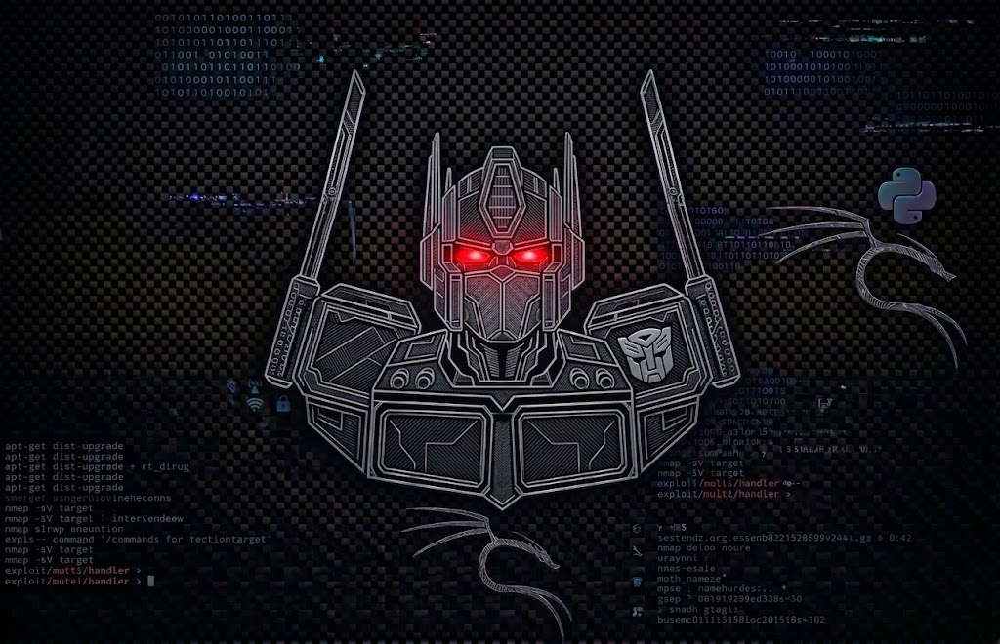

# Atom

A desktop companion that lives on your screen. Atom is a small pixel-art character
that roams your desktop in a transparent always-on-top window, reacts to what you
do, and answers questions in a chat panel that opens when you click it.

It is **local-first**: it can run entirely offline on [Ollama](https://ollama.com),
or use Gemini / your own logged-in DeepSeek session when you want faster or
stronger answers. There is no Atom server — nothing is sent anywhere except the
search queries and the provider you choose.



## What it does

- **Roams your desktop** as a 2D sprite or a 3D block character, with an idle
  animation state machine (walks, looks around, blinks, gets bored, sleeps).
- **Chat panel** with a typing reveal, timestamps, scrollback that survives
  restarts, and text-to-speech.
- **Multi-provider routing with fallback**: Ollama (local) → Gemini → Browser AI
  (DeepSeek through a real browser session you log into once). If one fails or is
  rate-limited, the next one answers.
- **Looks things up before answering** when a question is about something that
  changes (prices, news, versions, weather), instead of guessing from training data.
- **Remembers what you tell it** — facts are stored in `data/memory.json` and
  referenced naturally later. Nothing else is remembered.
- **Sees your screen** (optional OCR) and can comment on it in `stalk` mode.
- **Acts on your machine only with permission** — opening apps or URLs, or
  writing inside its sandbox, asks first (`yes` / `no`).
- **Six characters and five moods/modes**, all switchable in Settings.

## Requirements

| | |
|---|---|
| OS | Windows 10 / 11 (this is what it is developed and tested on) |
| Python | 3.10 or newer — 3.11 recommended |
| Disk | ~250 MB without a local model; +96 MB intro video; +2–4 GB if you pull an Ollama model |
| Optional | [Ollama](https://ollama.com) for offline answers, [Tesseract](https://github.com/UB-Mannheim/tesseract) for OCR, a Gemini API key, or a DeepSeek login |

## Quick start

```bat
git clone https://github.com/<owner>/atom.git
cd atom
setup_atom.bat
run_atom.bat
```

`setup_atom.bat` runs `setup_atom.py`, which is idempotent and needs no admin:

1. checks your Python version;
2. creates `.venv` in the project folder;
3. installs `requirements.txt`;
4. installs Playwright's Chromium (only needed for Browser AI);
5. creates `data/` and copies `data/.env.example` to `.env` if it does not exist;
6. verifies the Qt/imaging/TTS imports and reports what is missing;
7. reports whether Ollama and Tesseract are installed.

It does **not** download models or system installers. If you want that too:

```bat
python setup_atom.py --full
```

That also installs Ollama/Tesseract and pulls the default local model (~2 GB).
Atom itself also runs a dependency check on every launch, so a missing Ollama or
Tesseract is reported there rather than crashing the app.

Then start it with `run_atom.bat`.

## Configuration

Settings live in `data/config.json`, created with defaults on first run. The gear
icon in the chat panel (or `/settings`) opens the live editor: character, mode,
renderer (2D/3D), providers, TTS, permissions, theme.

- **Gemini** — put your key in `.env` (`GEMINI_API_KEY=...`). Multiple keys are
  supported and rotated round-robin.
- **Ollama** — start it, then pick it as the primary provider. Atom checks what
  is actually installed and uses the largest chat model rather than a name you
  never pulled.
- **Browser AI (DeepSeek)** — Settings → Advanced → *Login to DeepSeek* opens a
  real browser, waits for you to sign in, and saves the session to
  `data/browser_auth.json`. *Logout* deletes it.

**Which provider should you pick?** On a CPU-only machine, put **Gemini first**.
A local 3–8B model generates at roughly 5–10 tokens/second on CPU, so answers take
25 s or more; Gemini answers in a second or two. Ollama is the right choice for
offline use and for keeping everything on-device.

### Modes

`tap` (default, playful), `formal`, `stalk` (comments on your screen), `whisper`,
`lullaby`. Switch with `/mode <name>`, or `formal!!` to toggle the formal tone.

### Commands

Type `/help` for the list. The main ones: `/settings`, `/mode`, `/remember`,
`/forget`, `/memory`, `/mute` `/unmute`, `/speed`, `/status`, `/pose`, `/emotion`,
`/wave` `/jump` `/spin`, `/sleep` `/wake`, `/roam`, `/clear`, `/save`, `/browser`,
`/time`, `/intro`, `/workspace`, `/allow` `/deny`, `/quit`.

`exit`, `quit`, `bye` and `good night` also close it, and every action that touches
your machine is confirmed with `yes`/`no`.

## Privacy — what stays on your machine

| Path | What it is | Delete it to… |
|---|---|---|
| `data/config.json` | your settings | reset all settings |
| `data/memory.json` | facts you asked Atom to remember | wipe its memory |
| `data/chat_history.json` | the chat transcript (used to restore the panel) | start a fresh conversation |
| `data/browser_auth.json` | cookies from the DeepSeek login | log out (or use the Logout button) |
| `data/browser_profile/` | the dedicated browser profile | reset the browser session |
| `data/learned_targets.json` | app names it learned from `open` commands | forget them |
| `logs/` | debug logs | free space |

**What leaves the machine:** the text of a search query, sent to DuckDuckGo (with
Wikipedia/Brave fallbacks) only when a question needs current information; and the
prompt — your message, recent turns, and optionally OCR text or search results — to
whichever provider *you* configured (Gemini or DeepSeek). With Ollama selected,
nothing leaves the machine at all. There is no telemetry and no Atom account.

## Troubleshooting

- **"Atom is thinking…" for a long time** — a local model on CPU is slow. Check
  `logs/atom.log` for the provider line; switch to Gemini, or pull a smaller model
  and set `model_chat` in `data/config.json`.
- **`Could not find the Qt platform plugin "windows"`** — the venv is broken or
  PyQt6 is missing. Re-run `setup_atom.bat`.
- **No voice** — text-to-speech uses the Windows SAPI voice through `pyttsx3`;
  check `/status`, and `/tts on`.
- **Blank intro** — `assets/atom_intro.mp4` is missing; the intro falls back to a
  sprite animation on its own.
- **OCR does nothing** — install Tesseract (the installer adds it to `PATH`) or
  point `tesseract_path` at it in Settings.
- **No internet** — Atom falls back to Ollama only and says so in the log.

## Project layout

```
atom.py            entry point: providers, brain thread, input handling, shutdown
atom_cli.py        terminal-only mode
core/              brain, providers (ollama/gemini/browser), eyes (OCR), voice,
                   hands (actions), sandbox, memory/config, installer, web search
ui/                overlay + chat panel, animation machine, intro sequence,
                   2D sprite renderer, 3D block renderer
assets/            skins, logos, the intro video, the 3D model
data/              created at runtime (see Privacy); only .env.example ships
tests/             pytest suite (Qt offscreen, no network)
tools/             dev probes and asset generators (probe_full_run.py = end-to-end)
```

## Development

```bat
.venv\Scripts\python -m pytest tests -q
```

901 tests, no network required, GUI tests run on Qt's `offscreen` platform. The CI
workflow (`.github/workflows/ci.yml`) runs the same suite on `windows-latest`.

For an end-to-end check of what a user actually sees — intro, handoff to Atom, a
live search question, screenshots — run `python tools/probe_full_run.py` and look
in `logs/`.

## License

**GPL-3.0-only.** See [LICENSE](LICENSE).

Atom links against [PyQt6](https://riverbankcomputing.com/software/pyqt/), which
Riverbank Computing licenses under the GPLv3 (or a commercial licence). That makes
the distributed application a GPLv3 work: you are free to use, study, modify and
redistribute Atom, but a redistributed build must also be GPLv3 with source
available. If you need to ship Atom inside a closed-source product, you need a
commercial PyQt licence from Riverbank, and the GPL still applies to this code.

Contributions are accepted under GPL-3.0-only — see [CONTRIBUTING.md](CONTRIBUTING.md).
Third-party components and their licences are listed in
[THIRD_PARTY_NOTICES.md](THIRD_PARTY_NOTICES.md).
